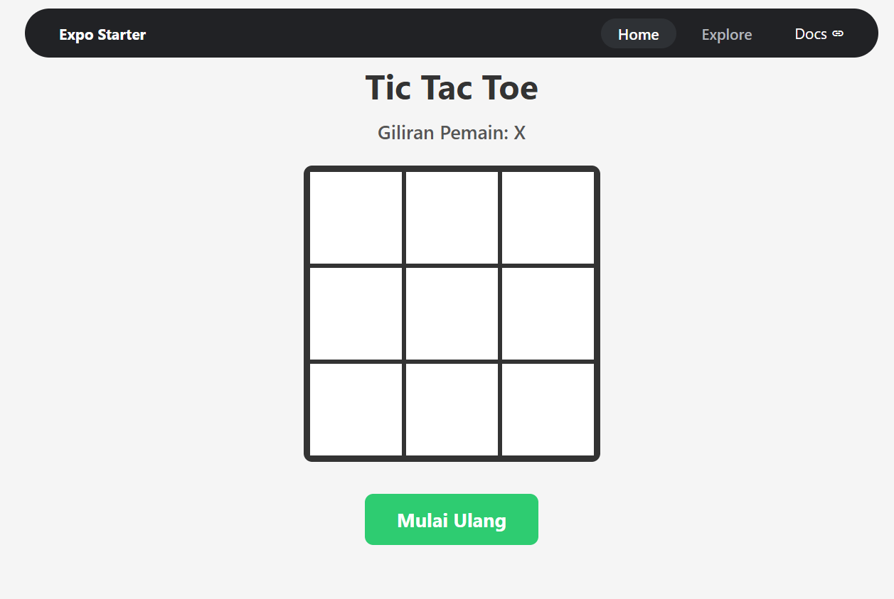
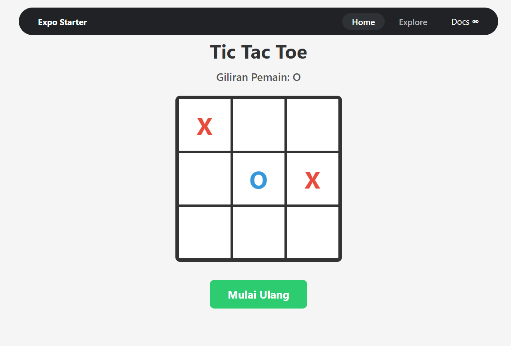
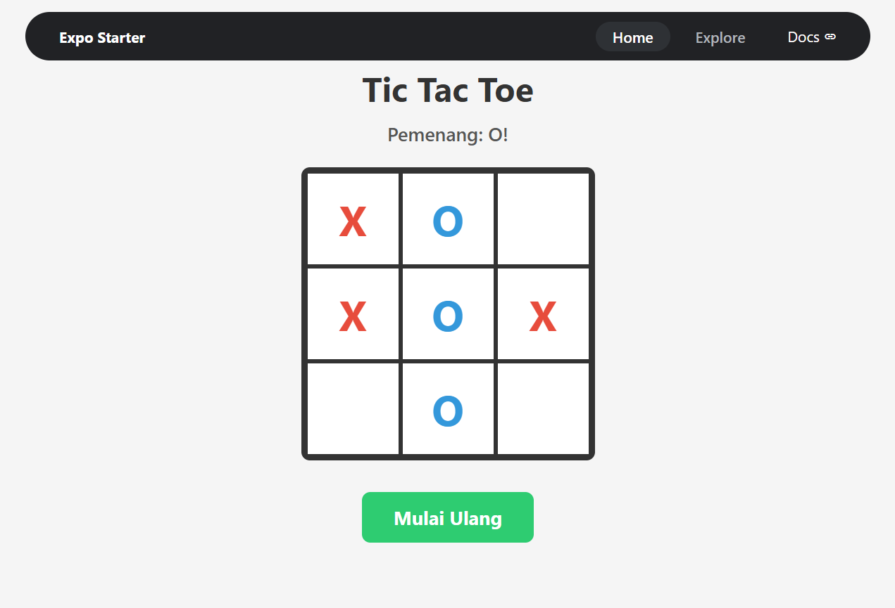
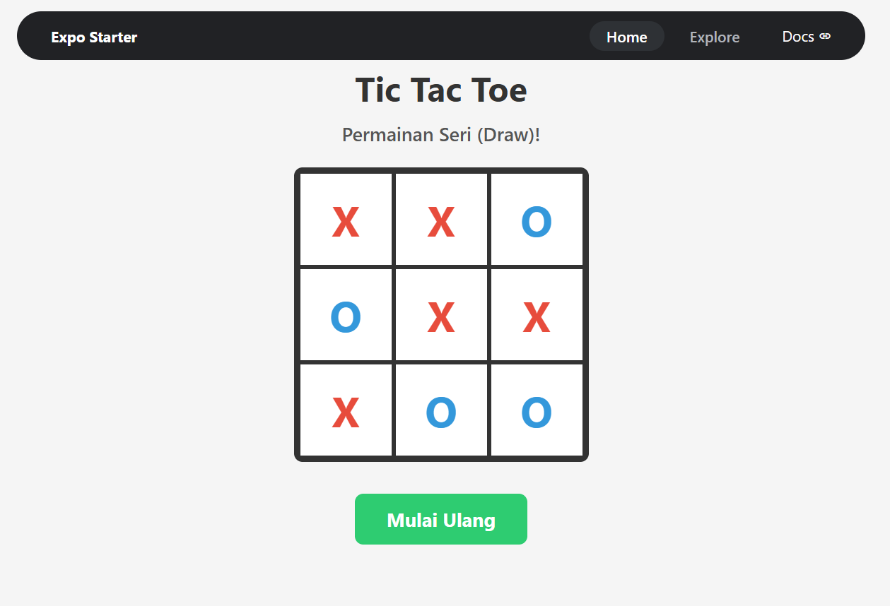

# Tic Tac Toe: Permainan dengan React Native dan Expo

Permainan Tic Tac Toe (XO) untuk dua pemain yang dibuat untuk tugas
mata kuliah Mobile Programming. Aplikasi ini dibuat dengan React Native
dan Expo, serta dijalankan di HP lewat aplikasi Expo Go dan bisa juga di web.

## Identitas

- Nama: Miraj Jamal Sidik
- NIM: 41155050240026
- Mata Kuliah: Mobile Programming

## Fitur

- Papan permainan 3x3, pemain X dan O bergantian menekan kotak.
- Teks status yang berubah otomatis: giliran pemain, pemenang, atau seri.
- Kotak yang sudah terisi tidak bisa ditimpa.
- Permainan terkunci setelah ada pemenang.
- Tombol **Mulai Ulang** untuk mengosongkan papan dan bermain lagi.

## Teknologi

- React Native dan Expo
- Hook `useState` untuk mengelola state permainan
- Flexbox untuk tata letak papan 3x3

## Cara Kerja Singkat

Papan disimpan sebagai array berisi 9 elemen (kosong, X, atau O), dan
giliran pemain disimpan dalam satu state tersendiri. Setiap kali kotak
ditekan, aplikasi membuat salinan baru dari papan, mengisinya dengan
simbol pemain, lalu menggantikan state lama. Setelah itu aplikasi
memeriksa 8 kemungkinan garis kemenangan (3 baris, 3 kolom, 2 diagonal).
Jika ada tiga simbol sama berjajar, pemenang ditampilkan. Jika semua
kotak terisi tanpa pemenang, hasilnya seri.

## Screenshot

### Papan Awal

### Permainan Berjalan

### Ada Pemenang

### Permainan Seri

## Cara Menjalankan

1. Clone repository ini, lalu masuk ke foldernya.
2. Install dependensi: `npm install`
3. Jalankan aplikasi: `npx expo start`
4. Scan QR Code dengan aplikasi Expo Go di HP.
